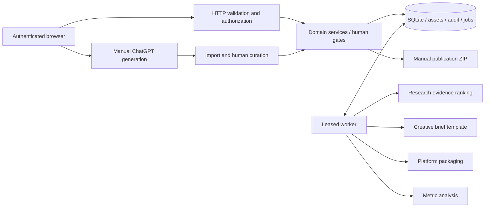
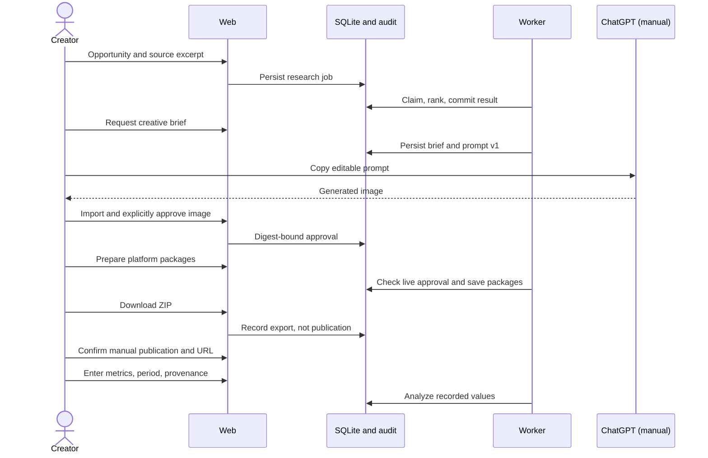

# Architecture and decisions

Variance is a local-first modular monolith: Python 3.12+ standard-library HTTP service, SQLite in WAL mode, and a buildless HTML/CSS/JavaScript client. No required paid services or packages. The implemented specialist adapters use supplied evidence, transparent creative templates, manual ChatGPT image creation, manual publication export, and user-entered metrics. These are labelled; no simulated research, model calls, or successful publication is presented as real.

## Architecture decision records

**ADR 001 — Python and SQLite.** One runtime and transactional persistence minimize local costs and operations. React/FastAPI/Postgres are alternatives, but add overhead before their capabilities are needed. HTTP transport, domain services, workers, persistence and browser components are separated. Trade-offs: a small client component system, limited image inspection, and a development-oriented HTTP server. Public hosting needs the hardening in deployment.md.

**ADR 002 — Durable state machine.** Use specialist handlers with versioned contracts, not unrestricted autonomous conversations. Deterministic code owns validation, ranking, state changes, approval, exports and numeric analysis. Templates are a zero-cost fallback, not represented as LLM intelligence. A general agent framework adds no value to the initial constrained workflow.

**ADR 003 — Human gates.** Assets are immutable and identified by SHA-256. Approval records identify user, asset and digest. Packaging and export recheck live approval. Rejection revokes approval and invalidates draft packages. Export never means published. Manual publication requires an explicit confirmation and a public URL. No external publishing adapter is enabled.

**ADR 004 — Private workspaces.** Salted PBKDF2 passwords, hashed expiring session tokens, per-session CSRF, workspace membership checks on every record access. No default credentials. Registration is local bootstrap; disable it after provisioning for shared operation. Settings do not accept integration secrets.

## Agent contracts v1

| Specialist | Input | Structured output | Permissions |
|---|---|---|---|
| Research | Title, source URL, excerpt, date, priority | Heuristic score and supplied provenance | Read campaign/profile; write research result |
| Creative director | Research, niche, audience, style, constraints | Brief, editable prompt, template version | Read profile/evidence; write creative result |
| Curation | PNG/JPEG/WebP bytes, creator decision | Digest, status, approval actor/time | Validate/store bytes; human-only decisions |
| Distribution | Current approved asset, brief/profile | Three platform captions, hashtags, alt text | Write packages; no network tools |
| Analyst | Recorded metrics, period, provenance | Calculated engagement and qualified recommendations | Read metrics; write analysis |

No specialist may execute code, fetch arbitrary URLs, generate images, or publish. Research evidence is untrusted data, rendered with escaping. URLs are stored and never fetched, avoiding SSRF. User-entered excerpts are traceable but not independently verified.

## Scheduling and recovery

Jobs carry workspace, campaign, kind, contract version, priority, unique idempotency key, attempts, lease, next-run time and error. SQLite `BEGIN IMMEDIATE` serializes claims; only one running job per campaign. Priority then creation time determines order. A 60-second lease recovers crashes. Handlers perform bounded local work and commit outputs, audit, state and success atomically. Retryable failures back off exponentially, maximum three attempts. Dependency/validation failures fail immediately. Cancellation persists a terminal state under the same lock. Failed/cancelled jobs may be retried with a new key. Completed tasks cannot be retried through that endpoint.

Research → brief → manual image import/approval → package → export → manual publication record → metrics → analysis. Dependency checks reject invalid transitions. Prompt edits invalidate draft packages but preserve approval of unchanged immutable images. Events retain source capture, prompt versions, actor decisions, exports and publication records. Dependencies communicate through persisted contracts, never free-form messages.

Structured result contracts are defined in `variance/contracts.py` and validated before completion commits. Metrics retain optional creator-supplied comment observations without claiming automated sentiment analysis. New briefs incorporate up to three prior analyzed projects as traceable reflection snapshots, explicitly framed as hypotheses rather than established facts.

## Scaling

All mutable domain records are workspace-scoped. Additional local worker processes can share transactional claims (`python -m variance.worker`). Keep SQLite on one host. Multi-host deployment should replace persistence/claims with Postgres row locks, assets with private object storage, and sessions with shared storage. Preserve idempotency and a transactional outbox. Future paid model adapters must validate structured output and explicit budgets. Authorized publishing adapters require scoped credentials, rate limits, fresh approval at execution, provider idempotency and reconciliation of uncertain outcomes; SQLite transactions alone cannot make external side effects atomic.
